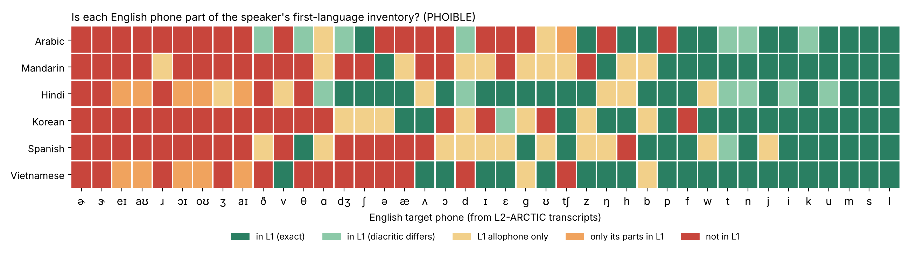
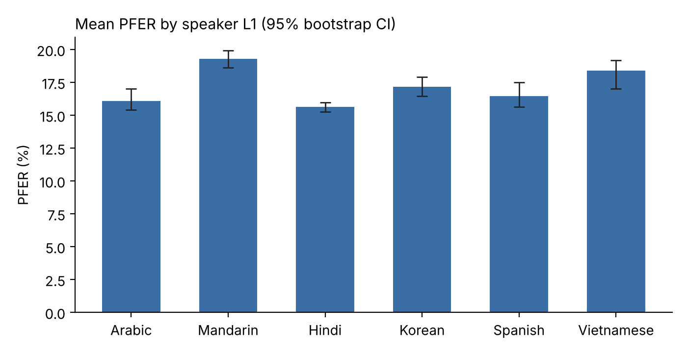
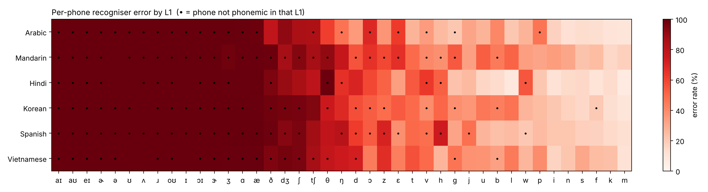
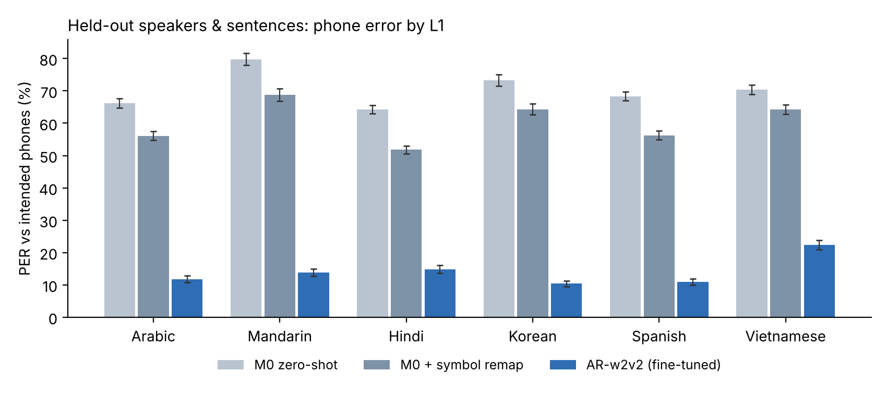
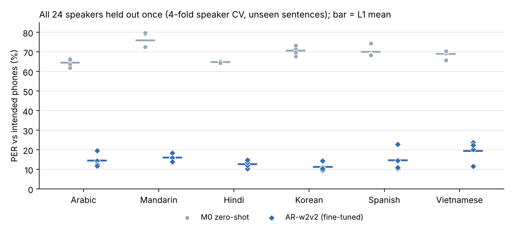

# Abstract

Universal phone recognisers promise IPA transcription of any speech, including languages and accents absent from their training data. This project evaluates one such model, a wav2vec2-XLSR recogniser fine-tuned on seven languages, none of them English (Taguchi et al., 2023). The test set is the L2-ARCTIC corpus of non-native English: 24 speakers from six first-language (L1) backgrounds, 26,867 utterances. The project asks three questions. How accurately does the model transcribe L2 English? Does accuracy differ by the speaker's L1? Do errors concentrate on English phones that are absent from the speaker's L1 phoneme inventory?

Against dictionary pronunciations the model reaches a phone feature error rate (PFER) of **17.2%** and a phone error rate (PER) of **68.6%**. The high PER is driven by systematic zero-shot substitutions: twelve English phones, including /ɹ ɪ ə ʌ/ and all five diphthongs, are never transcribed with the English symbol (e.g. /ɹ/ → [r]/[ɾ], /ɪ/ → [i]). Accuracy differs by L1 (Kruskal–Wallis on speaker means, H = 16.7, p = 0.005). Mandarin speakers are transcribed least accurately (PFER 19.3%) and Hindi speakers most accurately (15.6%).

A PHOIBLE comparison shows that between 7 (Arabic) and 13 (Mandarin) of the 24 English consonants are not phonemic in each L1. For the same English consonant, the recogniser's error rate is **6.9 percentage points higher** when the speaker's L1 lacks it, after removing overall phone and L1 difficulty (permutation p = 0.004). Against what human annotators actually heard, the difference is 8.1 points (p < 0.001). Vowels show no such effect. Known accent patterns appear clearly in the output, among them Arabic /p/ → [b], Hindi /w/ ↔ /v/ and Spanish /z/ → [s].

**A proposed accent-robust model.** To resolve these limitations, the model was fine-tuned for 95 minutes on a laptop GPU, using L2 English speech labelled with the *intended* English phones, plus a small auxiliary head that predicts the speaker's L1. The fine-tuned model (AR-w2v2) was evaluated with 4-fold speaker cross-validation, so every one of the 24 speakers was tested once, always on sentences unseen in training.

* **Accuracy.** Phone error fell from 69.2% to **14.8%**, and PFER from 17.2% to 6.1%. All 24 speakers improved (Wilcoxon p < 10⁻⁶).
* **Accent robustness.** Where speakers mispronounced a phone, the model recovered the intended phone 72% of the time, against 12% before.
* **L1 bias.** The extra error on consonants missing from the speaker's L1 fell from 7.0 to 1.7 points, which is no longer significant (p = 0.09). The differences between L1 groups also became non-significant (Kruskal–Wallis p = 0.004 → 0.13). Vietnamese speakers remain the hardest group.
* **Accent identification.** The L1 head reached 39% on unseen speakers against 17% chance, so it does not reliably identify accents.

The revision also corrects five methodological problems in the 2024 pipeline. One of them had made the previously reported inventory overlaps (Jaccard 0.07–0.11) tokenisation artefacts; the corrected values are 0.19–0.50.

# 1. Introduction

Automatic phonetic transcription is useful for documenting low-resource languages, for pronunciation training, and for studying accents. Phone-level recognisers trained on many languages, such as Allosaurus and Wav2Vec2Phoneme, aim to produce IPA for any input. Taguchi et al. (2023) showed that a much smaller training set can work: about 1,000 utterances in each of 7 languages, transcribed into IPA semi-automatically, were enough for wav2vec2-XLSR to reach a phone feature error rate (PFER) of 21.2% on four unseen languages. Human inter-annotator agreement on the same languages was 19.6%.

Non-native speech is a demanding test for such a model. L2 speakers often replace an English phone that their L1 lacks with the closest L1 category, for example /θ/ → [s] or [t], or /v/ → [w] or [b]. A truly *phonetic* recogniser should transcribe what was actually said. Two consequences follow:

* Measured against the dictionary (canonical) pronunciation, errors should be higher on phones that are new to the speaker's L1. These errors mix genuine accent with model error.
* Measured against what human annotators heard, that L1 pattern should shrink, because the remaining errors reflect the model itself.

**Research questions.**

* **RQ1:** What PER/PFER does a zero-shot universal recogniser achieve on L2 English?
* **RQ2:** Does it differ by speaker L1 (Arabic, Mandarin, Hindi, Korean, Spanish, Vietnamese)?
* **RQ3:** Which English phones are not phonemic in each L1, and (H1) is the recogniser's per-phone error rate higher for a given English phone when the speaker's L1 lacks it?

# 2. Data and model

**L2-ARCTIC v5.0** (Zhao et al., 2018) contains 26,867 utterances (27.1 h) of CMU ARCTIC prompts read by 24 non-native speakers: 4 per L1, gender-balanced. Each utterance has a forced-aligned TextGrid of canonical ARPAbet phones. A subset of 3,599 utterances was annotated by hand for mispronunciations: 14,098 substitutions, 3,420 deletions and 1,092 additions.

**Model.** `ctaguchi/wav2vec2-large-xlsr-japlmthufielta-ipa1000-ns` is wav2vec2-XLSR-53 fine-tuned with CTC on about 1,000 CommonVoice 11.0 utterances per language. The languages are Japanese, Polish, Maltese, Hungarian, Finnish, Greek and Tamil, about 9.7 h in total (Taguchi et al., 2023). **English is not among them**, so every result here is zero-shot. Its output vocabulary has 314 symbols and contains every character needed to write the English targets. However, the fine-tuning data rarely or never used some of them, such as ɹ, ɪ and ə, so in practice the model may never output them (§4.2).

**PHOIBLE 2.0** (Moran & McCloy, 2019) contains 105,484 segment rows from 3,020 phoneme inventories. L1 inventories were selected by ISO 639-3 code: arb, cmn, hin, kor, spa and vie, with 1, 4, 5, 4, 5 and 4 inventories respectively.

# 3. Methods

## 3.1 Corrections to the 2024 pipeline

| # | 2024 implementation | Problem | Fix |
|---|---|---|---|
| 1 | `zip(os.listdir(wav), os.listdir(textgrid), os.listdir(transcript))` | Pairing depends on directory order. A single missing file shifts every later pair. | Pair by utterance ID. Tested with a deliberately missing file. |
| 2 | Stress digits stripped before ARPAbet→IPA | Every unstressed `AH0`/`ER0` (*the*, *a*, *-er*) became /ʌ/, /ɝ/ instead of /ə/, /ɚ/. This inflates errors on very frequent function words. | Stress-aware mapping. |
| 3 | `lingpy.ipa2tokens` on unspaced utterances | Adjacent vowels across word boundaries fused into pseudo-segments. For the Arabic group, **142 of the 179 "phones" were not English phones at all** (e.g. *ʌoʊ*, *iʌʌ*, *uaɪæ*). | Deterministic segmenter that keeps affricates and diphthongs whole and attaches diacritics. |
| 4 | PHOIBLE rows selected by `LanguageName.contains(...)`; ASCII *g* vs IPA *ɡ*; *tʃ* vs *t̠ʃ* | Pulled in unrelated or extra varieties, and some shared segments could never match. | ISO-code selection, Unicode normalisation, majority rule across inventories. |
| 5 | `panphon.feature_edit_distance` reported raw | Not divided by length, so longer sentences score worse. Not comparable across utterances. | Divide by reference length (PFER rate), alongside PER. |

## 3.2 Metrics

**PER** is the Levenshtein distance between the predicted and reference segment sequences, divided by the reference length. Two segments match if they are identical after removing length, aspiration and place-detail diacritics. **PFER** uses PanPhon's feature edit distance (Mortensen et al., 2016): substitution costs the fraction of the 24 articulatory features that differ, and insertion or deletion costs 1. The total is divided by the reference length.

Model output is split into segments as follows. A tie bar marks an affricate (t͡s is one segment, while plain ts is t + s). Diacritics attach to their base. Adjacent vowels that spell an English diphthong (aɪ, aʊ, eɪ, oʊ, ɔɪ) are joined so they can align with the single reference diphthong. A diphthong written with a glide, such as [aj], counts as a substitution under PER but costs little under PFER. Annotator labels in the perceived reference were normalised before scoring. Some annotators used `AX` for schwa or added stray punctuation (`ER)`, `D_`); this affected 0.3% of perceived labels.

Each utterance is scored against two references. The **canonical** reference is the forced-aligned dictionary phones, available for all utterances. The **perceived** reference is what annotators heard, available for the 3,599-utterance subset.

## 3.3 Inventory comparison (Part A)

The 41 English targets are the 39 ARPAbet phones plus /ə/ and /ɚ/. Each target is assigned to a category for each L1:

* **exact:** the phoneme appears in at least half of that language's PHOIBLE inventories.
* **close:** the same base segment with a different diacritic, e.g. dental [t̪] for /t/, or [iː] for /i/.
* **allophone only:** the sound occurs in the L1, but only as a variant of another phoneme, e.g. Spanish [ð] as a variant of /d/.
* **parts only:** a diphthong or affricate that is not a unit in the L1, although its components are.
* **absent.**

A target counts as *not phonemic* in the L1 if it is allophone-only, parts-only or absent.

As a sanity check, the same procedure was applied to PHOIBLE's nine English inventories. In 7 of 9, every English consonant target was found. The misses were /ɹ/ written as ɻ or r in two sources, and /k t/ written as kx and ts in the New Zealand inventory. Vowel matching was much less reliable: even the American English inventories "lack" /ɝ/, and individual sources omit /i ɔ eɪ ə/ because they transcribe them differently. **Consonant results are therefore the primary result, and vowel results are reported with that caveat.**

## 3.4 Testing H1 (Part B)

For each (L1, English phone) cell with at least 30 reference tokens, the per-phone error rate is the share of aligned reference tokens that the model did not output correctly.

For each phone, H1 compares the mean error rate of L1 groups that lack the phone with that of groups that have it. These within-phone differences are averaged across the 24 phones for which some groups lack the phone and others have it. Because the comparison is made within each phone, phones that are hard for every group (e.g. /ɹ/) cannot create an effect. A phone the model never outputs correctly has an error of about 100% for every group and contributes a difference of about zero, which makes the test conservative.

**Robustness to L1 difficulty.** Groups that lack many English phones, such as Mandarin, may also be harder to transcribe overall. The difference is therefore recomputed after removing both the phone's mean error and the L1 group's mean error (an additive two-way adjustment). This is done separately for consonants and vowels.

Significance comes from two-sided permutation tests that shuffle the L1-status labels within each phone: 5,000 shuffles for the main test and 2,000 for the adjusted test. L1 differences in mean PFER (RQ2) are tested with Kruskal–Wallis on per-speaker means, and 95% CIs come from bootstrap resampling of speakers. Utterances from the same speaker are not independent, so the speaker (n = 4 per L1) is the unit of analysis.

# 4. Results

## 4.1 English phones that are new to each L1 group (Part A)



| L1 | PHOIBLE inventories | English consonants not phonemic in L1 (of 24) | Targets covered, all 41 | Jaccard (corrected) | Jaccard (2024) |
|---|---|---|---|---|---|
| Arabic (Standard) | 1 | **7**: p, tʃ, v, ŋ, ɡ, ɹ, ʒ | 46% | 0.36 | 0.087 |
| Mandarin | 4 | **13**: b, d, ɡ, dʒ, tʃ, h, v, z, ð, θ, ɹ, ʃ, ʒ | 34% | 0.19 | 0.075 |
| Hindi | 5 | **8**: h, v, w, ð, θ, ŋ, ɹ, ʒ | 61% | 0.50 | 0.069 |
| Korean | 4 | **12**: b, d, ɡ, dʒ, f, v, z, ð, θ, ɹ, ʃ, ʒ | 41% | 0.31 | 0.105 |
| Spanish | 5 | **12**: d, dʒ, h, j, v, w, z, ð, ŋ, ɹ, ʃ, ʒ | 34% | 0.29 | 0.109 |
| Vietnamese | 4 | **10**: b, d, ɡ, dʒ, tʃ, ð, θ, ɹ, ʃ, ʒ | 51% | 0.36 | 0.096 |
| Arabic (arb + Egyptian, Moroccan, Najdi; union) | 5 | 2: ŋ, ɹ | 68% | 0.47 | — |

Three patterns stand out:

1. **/ɹ/, /ʒ/ and the interdentals /θ ð/ are new for almost every group**, along with the rhotacised vowels /ɝ ɚ/.
2. **Voicing in stops is new for Mandarin, Korean and Vietnamese.** These languages contrast aspiration or implosion rather than voicing, so English /b d ɡ/ are allophones at best.
3. **Group-specific gaps:**
   * Arabic lacks /p v ɡ/. This predicts the well-known *p→b* confusion.
   * Korean lacks /f/.
   * Hindi distinguishes neither /v/ from /w/ (both realise /ʋ/) nor /h/ as a separate phoneme (it has /ɦ/).
   * Spanish has [ð], [z] and [ŋ] only as allophones, and lacks /ʃ/ and /dʒ/.

The Arabic result depends heavily on which variety is used as the reference. Adding the colloquial varieties brings in /p v ɡ ʒ/. Because the home dialects of the L2-ARCTIC Arabic speakers are not documented, conclusions about the Arabic group are the least certain.

The corrected Jaccard overlaps are 2–7 times the 2024 values. The 2024 values were dominated by pseudo-segments created during tokenisation (§3.1, item 3), and they should not be reported.

## 4.2 Recognition accuracy (RQ1)

The model was run on all **26,867 utterances**, about 35 minutes on an Apple-silicon MacBook Pro using MPS. Every utterance was paired by ID with its forced-aligned reference. None was empty or duplicated, and all 3,599 annotated utterances received a perceived reference.

| Reference | Utterances | PER | PFER |
|---|---|---|---|
| Canonical (dictionary) | 26,867 | 68.6% | 17.2% |
| Perceived (annotated subset) | 3,599 | 64.7% | 15.5% |

PFER is within the range Taguchi et al. (2023) report for unseen languages (21.2%), and PER is far higher. Most of the gap comes from systematic symbol substitutions that make every token of a phone wrong under PER but cost only one or two features under PFER. **Twelve English targets were never output correctly by any group:** /ɹ ɪ ə ʊ ʌ ɚ ɝ/ and the diphthongs /aɪ aʊ eɪ oʊ ɔɪ/. /ʒ ɑ æ ð ʃ dʒ/ are output correctly less than 10% of the time.

| English phone | Most common outputs (all speakers) |
|---|---|
| ɹ | [r] 7,262 · [ɾ] 6,312 |
| ɪ | [i], [e], [ɨ] |
| ə | [a], [ɛ], [ɨ] |
| æ | [a] 11,377 · [ɛ] 6,936 |
| ʌ | [a] 9,241 · [ɔ] 5,225 |
| ð | [d] 10,046 · [t] 2,265 |
| ʃ | [ɕ] 2,974 · [ʂ] 1,569 |
| dʒ | [dʑ] 1,736 |
| eɪ | [j], [e], [i] (split into vowel + glide) |

These are the nearest categories in the training languages. Japanese, Polish and Finnish have trilled or tapped /r/. Polish has [ɕ ʂ dʑ] where English has [ʃ dʒ]. None of the seven languages has a lax /ɪ/ or a schwa as a separate vowel. The model effectively transcribes English "through" its training inventories, as in *"Typhoid, did I tell you"* → [t͡sajfɔjddɨdajt͡sɛuju] from an Arabic-L1 speaker: /t/ becomes [t͡s], /aɪ/ becomes [aj], and /l/ is lost before /j/.

## 4.3 Differences between L1 groups (RQ2)



| L1 | Canonical PER | Canonical PFER [95% CI] | Perceived PER | Perceived PFER [95% CI] |
|---|---|---|---|---|
| Arabic | 63.9% | 16.1% [15.4, 17.0] | 59.8% | 14.7% [14.1, 15.1] |
| Mandarin | 75.3% | **19.3%** [18.6, 19.9] | 71.2% | **17.4%** [16.3, 18.5] |
| Hindi | 64.1% | **15.6%** [15.3, 16.0] | 61.3% | **13.9%** [13.4, 14.4] |
| Korean | 69.9% | 17.1% [16.4, 17.9] | 68.1% | 16.4% [15.6, 17.3] |
| Spanish | 69.7% | 16.4% [15.6, 17.5] | 64.4% | 15.3% [14.8, 16.0] |
| Vietnamese | 68.7% | 18.4% [17.0, 19.2] | 63.3% | 15.2% [14.5, 16.3] |

The groups differ significantly. Kruskal–Wallis on the 24 speaker means gives H = 16.7, p = 0.005 against the canonical reference and H = 16.4, p = 0.006 against the perceived one. Speaker means range from 15.1% to 20.2% PFER. Every group scores better against the perceived reference, which means part of the canonical "error" is the model correctly hearing accented pronunciation.

Across the six groups, PFER rises with the number of English consonants missing from the L1 (Spearman ρ = 0.75). With only six groups this is suggestive rather than significant (p = 0.08). Mandarin has the most missing consonants (13) and the highest error. Hindi has among the fewest (8), the highest inventory overlap (Jaccard 0.50) and the lowest error. Arabic (7 missing) does not fit this ordering cleanly.

## 4.4 Errors concentrate on phones missing from the L1 (RQ3, H1)



| Comparison (24 phones with a contrast) | Canonical reference | Perceived reference |
|---|---|---|
| All phones, within-phone difference | **+6.8 points**, p < 0.001 | **+7.0 points**, p < 0.001 |
| All phones, adjusted for L1 difficulty | +5.9 points, p < 0.001 | +6.3 points, p < 0.001 |
| Consonants only (16), adjusted | **+6.9 points**, p = 0.004 | **+8.1 points**, p < 0.001 |
| Vowels only (8), adjusted | +0.8 points, p = 0.63 | +0.9 points, p = 0.56 |

H1 is supported for consonants and not for vowels. For vowels the null result is expected for two reasons. Several vowels are never output correctly by the model for any group, and the PHOIBLE vowel classification is itself unreliable (§3.3).

**Phone-level evidence (canonical reference).** The largest per-phone excesses are:

| Phone | Error in groups lacking it vs. groups having it | Groups lacking it |
|---|---|---|
| /h/ | +20.5 points | Hindi, Mandarin, Spanish |
| /ð/ | +18.7 points | five groups |
| /p/ | +18.2 points | Arabic |
| /θ/ | +15.2 points | four groups |
| /b/ | +14.3 points | Korean, Mandarin, Vietnamese |
| /ɡ/ | +12.8 points | Arabic, Korean, Mandarin, Vietnamese |

Several textbook L2 patterns show up directly in what the model outputs:

| Group | Phone | Error (this group vs. other groups) | Most common output |
|---|---|---|---|
| Arabic | /p/ | 46% vs 28% | [b] |
| Arabic | /b/ | 41% vs 32% | [p] |
| Hindi | /w/ | 55% vs 27% | [v] or [ʋ] |
| Hindi | /v/ | 63% vs 43% | [f] or [w] |
| Spanish | /z/ | 71% vs 53% | [s] |
| Mandarin | /θ/ | 91% vs 78% | [s] |

The Arabic /b/ excess points to a p/b confusion in both directions. Hindi /v/ and /w/ are both realisations of a single /ʋ/.

Two predictions were *not* borne out. Korean /f/ shows little excess (20% vs 18%). Arabic /v/ is transcribed *better* than in other groups (35% vs 48%), which is consistent with colloquial Arabic varieties having /v/ (§4.1). /ŋ/ also runs against H1 (−8.4 points).

# 5. Discussion

**The model is a phonetic transcriber of L2 English only up to its own inventory.** PFER of about 17% sounds close to the 19.6% human agreement that Taguchi et al. (2023) reported for unseen languages. However, a PER near 70% shows that, symbol for symbol, the output is rarely the English phone. The errors are not random: they are the nearest phones in Japanese, Polish, Finnish and the other training languages. For uses that need English-specific contrasts, such as pronunciation feedback on /ɪ/ vs /i/ or on /ɹ/, this model cannot be used zero-shot. Fine-tuning on a small amount of English (or L2-English) IPA data is the obvious remedy.

**L1 shapes the errors beyond the model's own biases.** The within-phone design compares each English phone with itself across groups, so the effect is not explained by some phones being hard. It survives removing each L1 group's overall difficulty. It is specific to consonants, where PHOIBLE classification is reliable, and it matches well-documented accent patterns.

**Why the effect persists against the perceived reference.** The introduction predicted that the effect should shrink once accent is accounted for. Instead it grew slightly, from 6.9 to 8.1 points for consonants. There are two plausible explanations, which this data cannot separate:

* L2-ARCTIC annotators label only clear phoneme-level substitutions. Sub-phonemic accent, such as a partly devoiced /b/ or a weakly fricated /θ/, remains in the "perceived" reference and is still counted as model error.
* The model may genuinely be less reliable on accented realisations of phones it has seen few of.

Distinguishing the two would need narrow phonetic annotation, or a model fine-tuned on English.

**Limitations.**

* There are only 4 speakers per L1. Speaker idiosyncrasy and L1 are confounded, and the L1-level correlation rests on six points.
* The permutation tests treat (L1, phone) cells as exchangeable. They do not model speaker-level variation within the cells.
* The canonical reference is a forced alignment of dictionary pronunciations, so it inherits aligner errors and ignores legitimate variation such as flapping.
* The home dialects of the Arabic speakers are undocumented, and Arabic results depend on the reference variety.
* PHOIBLE vowel notation is inconsistent across sources, and allophone lists are incomplete, so "absent" sometimes over-states the gap.
* Diphthongs are scored strictly under PER (e.g. [aj] vs /aɪ/). PFER is the fairer metric for them.
* Only one recogniser was evaluated.

**Future work.**

* Compare with an English-trained phone recogniser, e.g. Wav2Vec2Phoneme or Allosaurus.
* Fine-tune the model on a small English subset and measure how much of the L1 effect remains.
* Model errors with mixed-effects logistic regression at the token level (speaker and phone as random effects).

# 6. A proposed model: accent-robust fine-tuning (AR-w2v2)

Sections 4–5 identified three limitations of the zero-shot model on L2 English:

* **(L1) Wrong symbol set.** Twelve English phones are never produced.
* **(L2) Accent leaks into the output.** Accented realisations are transcribed as such, so a Mandarin speaker's [s] for /θ/ comes out as [s].
* **(L3) Unequal accuracy.** Error is higher for speakers whose L1 lacks the phone, and higher for some L1 groups overall.

The goal set for the new model was to output the **intended** English pronunciation. For *think* said as [sɪŋk], it should produce /θɪŋk/. As a secondary goal, it should also report *which* accent it heard.

## 6.1 Model

AR-w2v2 starts from the same checkpoint, so the comparison isolates the effect of the training.

* **Output layer.** The 314-symbol output layer already contains every English IPA character, so no layer is re-initialised.
* **CTC target.** It is the *canonical* phone sequence from the forced-aligned TextGrids (stress-aware; affricates written with tie bars, as in the model vocabulary).
* **L1 head.** A linear 6-way classifier is added on the mean-pooled final hidden layer. The loss is CTC + 0.2 × cross-entropy(L1).
* **Frozen and augmented parts.** The convolutional feature encoder is frozen, and SpecAugment is kept from the base configuration.

## 6.2 Data split and training

Every L2-ARCTIC speaker reads the same prompts, so a speaker-only split would let the model memorise sentences. The split is therefore disjoint in **both speakers and sentences**:

* **Speakers.** One speaker per L1 is held out: ZHAA, TXHC, TNI, YKWK, NJS and TLV.
* **Sentences.** 235 of the 1,132 prompts are held out by a fixed hash.

| Split | Speakers | Sentences | Utterances |
|---|---|---|---|
| Train | 18 (3 per L1) | 897 | 15,904 |
| Validation | 18 | 235 held-out | 300 |
| **Test** | **6 unseen** | **235 unseen** | **1,410** (183 hand-annotated) |

Training ran for 3 epochs (4,521 steps) in 95 minutes on an Apple M4 Pro (24 GB, MPS), with these settings:

* **Optimiser:** AdamW, learning rate 3·10⁻⁵, 300 warm-up steps followed by linear decay.
* **Batches:** at most 24 s of audio each.
* **Memory:** gradient checkpointing.

Validation PER fell from 69.2% before training to 13.5%.

Two baselines use the same test set:

* **M0** is the zero-shot model.
* **M0 + symbol remap** replaces each output symbol of M0 with the English phone it is most often aligned to on the training split, for example [r] → /ɹ/. This tests how much of the improvement is mere relabelling, without any acoustic learning.

## 6.3 Results on the first held-out split (fold 0: ZHAA, TXHC, TNI, YKWK, NJS, TLV)



| Model | PER [95% CI] | PFER | Accent gap (max − min PER across L1s) | Intended phone recovered where speaker *mis*pronounced it | Accuracy where pronounced correctly | Missing-phone excess, consonants, L1-adjusted |
|---|---|---|---|---|---|---|
| M0 zero-shot | 70.4% [69.7, 71.1] | 17.4% | 15.5 pts | 13.2% | 44.5% | +5.7 pts (p = 0.04) |
| M0 + symbol remap | 60.3% [59.5, 61.0] | 21.0% | 17.0 pts | 21.8% | 56.2% | +7.7 pts (p = 0.005) |
| **AR-w2v2** | **14.0% [13.5, 14.5]** | **5.8%** | **11.9 pts** | **72.5%** | **92.0%** | **+3.5 pts** (p = 0.03) |

The missing-phone excess is the H1 test of §3.4 on the test set: 16 consonants, cells with at least 20 tokens. Mispronounced phones are counted on the 183 annotated test utterances (832 phones).

**L1 → resolved.** The phones the zero-shot model never produced are now mostly correct:

| Phone | M0 accuracy | Remap accuracy | AR-w2v2 accuracy |
|---|---|---|---|
| /ɹ/ | 0% | 49% | **88%** |
| /ɪ/ | 0% | 26% | **85%** |
| /ə/ | 0% | 1% | **77%** |
| /ʌ/ | 0% | 14% | **82%** |
| /æ/ | 0% | 55% | **90%** |
| /ð/ | 3% | 3% | **91%** |
| /θ/ | 21% | 21% | **77%** |

Relabelling explains only a small part of the gain: the remap baseline improves PER by 10 points, while fine-tuning improves it by 56. The remaining gain is genuine acoustic learning of English categories.

**L2 → largely resolved.** At positions where annotators heard a mispronunciation, AR-w2v2 outputs the intended phone 72% of the time, against 13% for M0. It reproduces what was actually said only 9% of the time, against 24% for M0.

**L3 → reduced, not eliminated.** The excess error on consonants missing from the speaker's L1 falls from +5.7 to +3.5 points after L1 adjustment, and remains significant (p = 0.03). The absolute PER spread across L1s narrows from 15.5 to 11.9 points.

Relative to the much lower error level, however, the groups now differ more:

| Test speaker (L1) | AR-w2v2 PER |
|---|---|
| TLV (Vietnamese) | **22.3%** (highest) |
| TNI (Hindi) | 14.8% |
| TXHC (Mandarin) | 13.9% |
| ZHAA (Arabic) | 11.8% |
| NJS (Spanish) | 10.9% |
| YKWK (Korean) | 10.4% (lowest) |

TLV's remaining errors concentrate on /ʃ tʃ dʒ z/ and back vowels. With one test speaker per L1, this cannot be attributed to Vietnamese as opposed to this particular speaker.

**Accent identification → not achieved.** The L1 head is 100% accurate on validation utterances from training speakers. On unseen speakers it reaches only 30.7% (chance 16.7%), and the majority vote is correct for only 2 of 6 speakers (Hindi and Vietnamese). With only three training speakers per L1, the head learned to recognise *speakers*, not accents.

## 6.4 Cross-validation over all 24 speakers

The results in §6.3 rest on one held-out speaker per L1. To test whether they hold for every speaker, the experiment was repeated as **4-fold speaker cross-validation**. In fold *k*, each L1 holds out its *k*-th speaker in alphabetical order, so each fold has 6 test speakers and the 4 folds together test all 24 speakers exactly once. All folds use the same 235 held-out sentences. Each fold was checked to have zero speaker overlap and zero sentence overlap between training and test.

All four folds were trained with the same recipe:

| Fold | Steps | Training time | Best validation PER |
|---|---|---|---|
| 0 | 4,521 | 95 min | 13.5% |
| 1 | 4,871 | 100 min | 12.7% |
| 2 | 4,957 | 104 min | 12.6% |
| 3 | 4,870 | 110 min | 13.4% |

The symbol-remap baseline was re-learned on each fold's own training split. Speaker means (n = 24) are the unit for every test.



| Model (24 held-out speakers) | PER (mean ± SD over speakers) | PFER | L1 gap (max − min L1 mean) | L1 effect, Kruskal–Wallis | Intended phone recovered where mispronounced | Accuracy where pronounced correctly | Missing-phone excess, consonants, L1-adjusted |
|---|---|---|---|---|---|---|---|
| M0 zero-shot | 69.2% ± 4.6 | 17.2% | 11.4 pts | H = 17.5, **p = 0.004** | 11.6% | 44.8% | **+7.0 pts** (p < 0.001) |
| M0 + symbol remap | 58.9% ± 5.4 | 19.8% | 14.2 pts | H = 19.1, **p = 0.002** | 22.7% | 56.3% | **+7.7 pts** (p < 0.001) |
| **AR-w2v2** | **14.8% ± 4.3** | **6.1%** | **8.2 pts** | H = 8.6, p = 0.13 | **72.0%** | **91.9%** | +1.7 pts (p = 0.09) |

Mispronounced phones are counted on all 732 hand-annotated test utterances across the folds (3,587 mispronounced phones). On those phones, AR-w2v2 reproduces what was actually said only 13.9% of the time, against 24.6% for M0.

**The improvement is universal.** Fine-tuning lowered PER for **all 24 speakers**, by 54.4 points on average (Wilcoxon signed-rank p = 1.2 × 10⁻⁷, the smallest p attainable with 24 pairs). It beat the remap baseline for all 24 speakers too, by 44.1 points.

**The L1 effects are no longer detectable.**

* The zero-shot model's accuracy depended significantly on the speaker's L1 (p = 0.004). After fine-tuning, the L1 groups no longer differ significantly (p = 0.13).
* The extra error on consonants missing from the speaker's L1 falls from 7.0 to 1.7 points, which is not significant.

"Not significant" does not mean "absent". With 4 speakers per group, a small residual L1 effect cannot be ruled out.

**Vietnamese remains the hardest group, and the fold-0 picture was partly speaker-specific.**

| L1 | AR-w2v2 PER, mean (range over 4 speakers) |
|---|---|
| Korean | 11.3% (9.5–14.3) |
| Hindi | 12.7% (10.3–14.8) |
| Arabic | 14.5% (11.8–19.5) |
| Spanish | 14.6% (10.4–22.8) |
| Mandarin | 16.1% (13.9–18.3) |
| Vietnamese | 19.4% (11.6–23.7) |

Three of the four Vietnamese speakers (HQTV, THV, TLV) are above 20%. That points to a group-level residual, not just one difficult speaker, though PNV (11.6%) shows it is not uniform. The single largest outlier is the Spanish speaker EBVS (22.8%).

**Accent identification stays weak.** Pooled over folds, the L1 head classifies 39.3% of utterances from unseen speakers correctly (chance 16.7%; per fold 31%, 62%, 38% and 26%). The majority vote is correct for 9 of 24 speakers. This confirms that three training speakers per accent are not enough for accent identification.

## 6.5 Discussion of the proposed model

Fine-tuning on only about 16 h of accented English is enough to turn a zero-shot universal recogniser into an accurate, largely accent-robust English phone recogniser. Cross-validation shows the improvement holds for every one of the 24 speakers on sentences the model never saw. It also removes the statistically detectable L1 bias of the zero-shot model.

The design choice has a cost. The model now *hides* accent, which is the goal here, but it makes the model unsuitable for pronunciation feedback. For that use, the same recipe trained on the *perceived* phones would be the right variant.

Part of the gain is probably top-down. The test sentences are new, but 80% of the word tokens in them (though only 509 of 920 word types) also occur in training sentences, so the model can partly infer intended phones from word context. This is desirable for recovering what was meant, but it should be kept in mind when interpreting "acoustic" accuracy.

**Limitations.**

* Each fold is a single training run, with no seed variation.
* All folds share one set of held-out sentences.
* With 4 speakers per L1, small residual L1 effects cannot be excluded.
* The L1-ID result shows the corpus has too few speakers per accent for accent identification.

**Next steps.**

* Add more speakers per L1 (e.g. Speech Accent Archive, or L2-ARCTIC's suitcase corpus) for the L1 head.
* Train a "what was said" variant on perceived phones and compare it on mispronunciation detection.
* Test on spontaneous speech.

# 7. Reproducibility

All code, results and figures are in the project folder. The inference run used Python 3.12 with torch, transformers, librosa and panphon 0.22.2 on Apple MPS. The analysis was then re-run in a second, independent environment, and it reproduced every number in the first run's tables exactly (maximum difference 0.0). The corrections described in §3.2 were applied before the final analysis and changed no reported value by more than 0.3 percentage points.

```bash
pip install torch transformers librosa panphon pandas scipy matplotlib
# L2-ARCTIC v5.0: request from https://psi.engr.tamu.edu/l2-arctic-corpus/ and unzip
python src/inventory_analysis.py --phoible phoible.csv --out results
python src/run_pfer_experiment.py infer --l2arctic data/l2arctic_release_v5.0 \
       --out results/predictions.csv --device mps
python src/run_pfer_experiment.py analyze --predictions results/predictions_v2.csv --out results
python src/run_pfer_experiment.py analyze --predictions results/predictions_v2.csv --out results \
       --reference perceived
python src/robustness_check.py          # L1-adjusted H1 test
python tests/test_pipeline.py           # self-tests (pairing, parsing, synthetic-effect recovery)
# proposed model (§6): manifest, fine-tuning (~95 min on M4 Pro), test predictions, comparison
python src/prepare_finetune.py
python src/finetune.py train --ram-gb 24 --max-hours 3      # or double-click run_finetune.command
python src/finetune.py predict --split test
python src/compare_models.py
# 4-fold speaker cross-validation (§6.4): folds 1-3 (~5.5 h, or double-click run_cv.command), pooled comparison
python src/cv_fold.py prepare --fold 1 && python src/cv_fold.py train --fold 1 --ram-gb 24 && python src/cv_fold.py predict --fold 1
python src/cv_compare.py && python src/plot_cv.py
```

`predictions_v2.csv` is `predictions.csv` with the perceived references rebuilt by the corrected annotation parser; the model outputs are identical. **Pipeline validation:** on synthetic data with a planted 35-point effect, the analysis measured +35.3 points (p = 0.0002), and with no planted effect it measured +0.1 points (p = 0.77).

# References

* Moran, S. & McCloy, D. (eds.) (2019). *PHOIBLE 2.0*. Max Planck Institute for the Science of Human History. https://phoible.org
* Mortensen, D. R., Littell, P., Bharadwaj, A., Goyal, K., Dyer, C. & Levin, L. (2016). PanPhon: A resource for mapping IPA segments to articulatory feature vectors. *COLING 2016*.
* Taguchi, C., Sakai, Y., Haghani, P. & Chiang, D. (2023). Universal automatic phonetic transcription into the International Phonetic Alphabet. *Interspeech 2023*. arXiv:2308.03917.
* Zhao, G., Sonsaat, S., Silpachai, A., Lucic, I., Chukharev-Hudilainen, E., Levis, J. & Gutierrez-Osuna, R. (2018). L2-ARCTIC: A non-native English speech corpus. *Interspeech 2018*.

---
*Code: `src/` (inventory analysis, inference and scoring, robustness check, fine-tuning and model comparison; fine-tuned weights in `models/ar_w2v2/`), `tests/test_pipeline.py`. Results: `results/`. Original 2024 code: `phone_recognition.ipynb` at the repository root (history in git). The initial `phone_recognition.py` scaffold was provided by project mentor Farhan Samir.*
